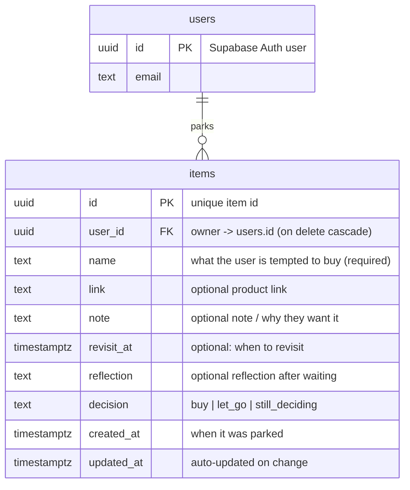

# Database diagram (ERD) — Park & Revisit

The app stores data in one table, `items`, in Supabase (PostgreSQL). Each item
belongs to one user. Users are managed by Supabase Auth in the built-in
`auth.users` table.

## How to read it

- **One user → many items** (the `||--o{` line). One person can park many items;
  every item belongs to exactly one person.
- **`user_id` is the link.** It stores which user owns the row. `ON DELETE
  CASCADE` means if a user is deleted, their items are deleted too.
- **Row Level Security** uses `user_id`: a row is only visible or changeable when
  `auth.uid() = user_id`, so each person sees only their own items.

The full table definition and the RLS policies live in
`supabase/migrations/0001_init.sql`.
